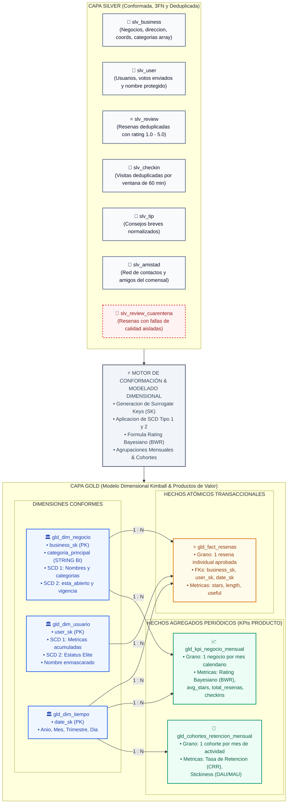
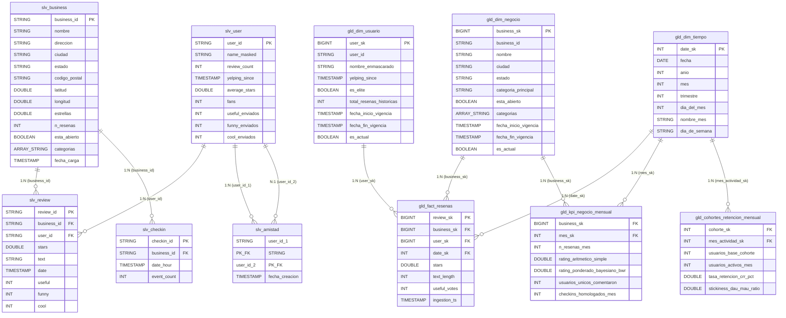

# Especificación de Diagrama: Modelo Lógico (Silver 3FN) y Modelo Dimensional (Gold Kimball)

> **Artefacto Asociado:** `modelo_logico_lakehouse_v3.drawio`  
> **Sección del Documento Formal:** [Secciones 4.2 y 4.3 · Modelo Lógico y Estrategia Dimensional para la Capa Gold (Entregable E3)](file:///Users/jhuertad/Desktop/cursos/arquitectura_datos/clase_09/Documento_Formal_Arquitectura_Datos_YelpConnect.md#42-modelo-lógico-y-decisiones-de-normalización)  
> **Caso de Uso Prioritario:** Dirección de Producto (Andrew Collins, VP of Product)  
> **Propósito de este archivo:** Insumo exhaustivo para generar el diagrama en **Draw.io** utilizando asistentes de IA, plugins de generación automática o importación nativa de Mermaid/Graphviz.

---

## 1. Prompt Maestro para la IA de Draw.io

```text
Actúa como un Diseñador y Modelador de Datos Senior experto en la Metodología Dimensional de Ralph Kimball y Arquitectura Medallion en Delta Lake.
Genera un diagrama integral en Draw.io estructurado en dos secciones principales conectadas por un flujo de transformación de ETL/ELT:

1. SECCIÓN SUPERIOR / IZQUIERDA: MODELO LÓGICO RELACIONAL EN SILVER (Tercera Forma Normal - 3FN)
   - Tablas normalizadas: slv_business, slv_user, slv_review, slv_checkin, slv_tip.
   - Tabla de excepción: slv_review_cuarentena (para registros que fallan Quality Gates).
   - Características: Claves naturales (UUIDs de negocio), tipificación estricta, restricciones CHECK y NOT NULL, colecciones como ARRAY<STRING>.

2. FLECHA DE TRANSFORMACIÓN CENTRAL:
   - "Conformación & Modelado Dimensional (PySpark / Delta Lake)"
   - Reglas aplicadas: Generación de Surrogate Keys (SK), tratamiento de historia (SCD Tipo 1 y 2), cálculo de Rating Bayesiano (BWR), agregación mensual y cálculo de retención de cohortes.

3. SECCIÓN INFERIOR / DERECHA: MODELO DIMENSIONAL EN GOLD (Esquema Estrella Kimball Multigranularidad)
   - DIMENSIONES CONFORMES:
     * gld_dim_negocio (SCD Tipo 1 para datos descriptivos, SCD Tipo 2 para estado operativo con fecha_inicio, fecha_fin, es_actual).
     * gld_dim_usuario (SCD Tipo 1 para métricas acumuladas, SCD Tipo 2 para estatus Élite, enmascaramiento dinámico de name).
     * gld_dim_tiempo (Dimensión calendario estática: fecha_sk, anio, mes, trimestre, dia_semana).
   - TABLA DE HECHOS ATÓMICOS (Grano Fino):
     * gld_fact_resenas (Grano: Una reseña individual por usuario, negocio y fecha. Métricas: stars, text_len, useful).
   - TABLAS DE HECHOS AGREGADOS PERIÓDICOS (Grano Resumido):
     * gld_kpi_negocio_mensual (Grano: Un registro por negocio y mes. Métricas: BWR, avg_stars, n_resenas, checkins).
     * gld_cohortes_retencion_mensual (Grano: Una cohorte de registro por mes de actividad. Métricas: usuarios_activos, crr_pct).

4. PALETA DE COLORES Y ESTILO VISUAL:
   - Zona Silver (3FN): Cajas con encabezado #64748B (Gris Slate), fondo blanco, bordes #94A3B8.
   - Zona Cuarentena: Encabezado #DC2626 (Rojo alerta), fondo #FEF2F2, borde discontinuo.
   - Dimensiones Gold: Encabezado #2563EB (Azul Real), fondo #EFF6FF, bordes #3B82F6.
   - Hechos Atómicos Gold: Encabezado #D97706 (Ámbar Dorado), fondo #FFFBEB, bordes #F59E0B.
   - Hechos Agregados Gold: Encabezado #059669 (Verde Esmeralda), fondo #ECFDF5, bordes #10B981.
   - Conectores: Ortogonales con flechas orientadas desde Dimensiones hacia Hechos (relación 1 a N).
```

---

## 2. Vista de Arquitectura a Nivel Funcional (Visión de Negocio)

### 2.1. Objetivo Funcional
Explicar a los líderes de la organización (**Andrew Collins de Producto**, **Laura Hernández CDO**) cómo las transacciones normalizadas y crudas se transforman en estructuras analíticas optimizadas que responden sin contradicciones a:
1. ¿Cuál es la verdadera satisfacción de los comensales en cada categoría? (Rating Bayesiano sin sesgo).
2. ¿Qué negocios tienen alta fidelidad y visitas recurrentes? (Check-ins homologados).
3. ¿Cómo se comportan las cohortes de usuarios en el tiempo? (Tasa de retención $CRR$ y Stickiness $DAU/MAU$).

### 2.2. Cumplimiento de los 12 Lineamientos Técnicos de Gold (Sesión 19)

| Lineamiento | Cómo se cumple en el diseño de Gold | Beneficio directo para Andrew Collins (VP Product) |
| :--- | :--- | :--- |
| **1. "El cálculo tiene dueño y propósito"** | Cada columna en Gold está respaldada por un KPI de Producto definido en el Glosario de Negocio. | No existen tablas huérfanas ni métricas no solicitadas. |
| **2. "El grano se declara, no se deduce"** | Cada tabla de hechos y agregados tiene un enunciado estricto de granularidad documentado. | Previene errores fatales de doble conteo al sumar métricas en BI. |
| **3. Prohibido mezclar granularidades** | Hechos transaccionales atómicos (`gld_fact_resenas`) viven en una tabla separada de los mensuales (`gld_kpi_negocio_mensual`). | Permite tanto auditoría profunda de una opinión como dashboards mensuales de alta velocidad. |
| **4. Dimensiones conformes compartidas** | `gld_dim_negocio` y `gld_dim_usuario` sirven tanto a hechos atómicos como agregados. | Garantiza coherencia matemática: la suma de partes siempre cuadra con el total consolidado. |
| **5. Tratamiento histórico formal (SCD)** | Cambios en el estado del local (`esta_abierto`) o estatus Élite del comensal generan nuevas versiones de fila (SCD Tipo 2). | Preserva el contexto histórico exacto en que ocurrió la reseña o la visita. |

### 2.3. Diagrama Funcional en Código Mermaid (Listo para Importar en Draw.io)



---

## 3. Vista de Arquitectura a Nivel Técnico (Esquema Físico y Tipos de Datos)

### 3.1. Objetivo Técnico
Especificar las columnas exactas, claves primarias (`PK`), claves foráneas (`FK`), claves sustitutas (`SK`), atributos de control histórico (`fecha_inicio_vigencia`, `fecha_fin_vigencia`, `es_actual`), tipos de datos de Delta Lake y estrategias de particionado.

### 3.2. Mapeo de Tablas Lógicas vs Objetos Físicos en Unity Catalog

| Tabla Lógica | Tabla Física en Unity Catalog | Rol en el Modelo | Grano Físico Declarado | Clave Primaria / SK |
| :--- | :--- | :--- | :--- | :--- |
| `BUSINESS` | `workspace.yelp_silver.slv_business` | Relacional 3FN | Un registro por negocio activo (excluye `attributes` y `hours` retenidos en Bronze según **ADR-07**). | `business_id` (STRING) |
| `REVIEW` | `workspace.yelp_silver.slv_review` | Relacional 3FN | Una reseña válida deduplicada. | `review_id` (STRING) |
| `USER` | `workspace.yelp_silver.slv_user` | Relacional 3FN | Un usuario registrado. | `user_id` (STRING) |
| `CHECKIN` | `workspace.yelp_silver.slv_checkin` | Relacional 3FN | Un check-in deduplicado por hora. | `checkin_id` (STRING) |
| `CUARENTENA` | `workspace.yelp_silver.slv_review_cuarentena` | Buffer de Aislamiento | Una reseña no conforme retenida. | `review_id` + `motivo_rechazo` |
| `DIM_NEGOCIO` | `workspace.yelp_gold.gld_dim_negocio` | Dimensión SCD 1 & 2 | Un estado de vigencia del negocio. | `business_sk` (BIGINT) |
| `DIM_USUARIO` | `workspace.yelp_gold.gld_dim_usuario` | Dimensión SCD 1 & 2 | Un estado de vigencia del usuario. | `user_sk` (BIGINT) |
| `DIM_TIEMPO` | `workspace.yelp_gold.gld_dim_tiempo` | Dimensión Conforme | Una fecha calendario. | `date_sk` (INT: YYYYMMDD) |
| `FACT_RESENAS`| `workspace.yelp_gold.gld_fact_resenas` | Hecho Atómico | Una reseña validada por evento. | `review_sk` (BIGINT) |
| `KPI_MENSUAL` | `workspace.yelp_gold.gld_kpi_negocio_mensual` | Hecho Agregado Periódico | Un negocio y un mes calendario. | `business_sk` + `mes_sk` |
| `COHORTES` | `workspace.yelp_gold.gld_cohortes_retencion_mensual` | Hecho Agregado Periódico | Una cohorte y un mes evaluado. | `cohorte_sk` + `mes_actividad_sk` |

### 3.3. Diagrama Técnico en Código Mermaid (Diagrama ER Relacional y Estrella)



---

## 4. Parámetros de Estilo Recomendados para Draw.io

Para que el asistente de Draw.io cree un diagrama estético de estándar profesional:
* **Layout:** Dual Swimlane / Vertical Partition (Parte superior: Silver 3FN; Parte inferior: Gold Kimball).
* **Forma de Entidades:** Tablas formales tipo base de datos (`shape=table;rowLabels=0;childLayout=tableLayout;`).
* **Estilo de Claves:** Iconos o negritas para `PK` (amarillo dorado/llave), `FK` (azul/conector), `SK` (verde/surogate).
* **Conectores Dimensionales:** Estilo ortogonal limpio con etiqueta de cardinalidad 1 a N claramente legible sin encimarse en las tablas.
