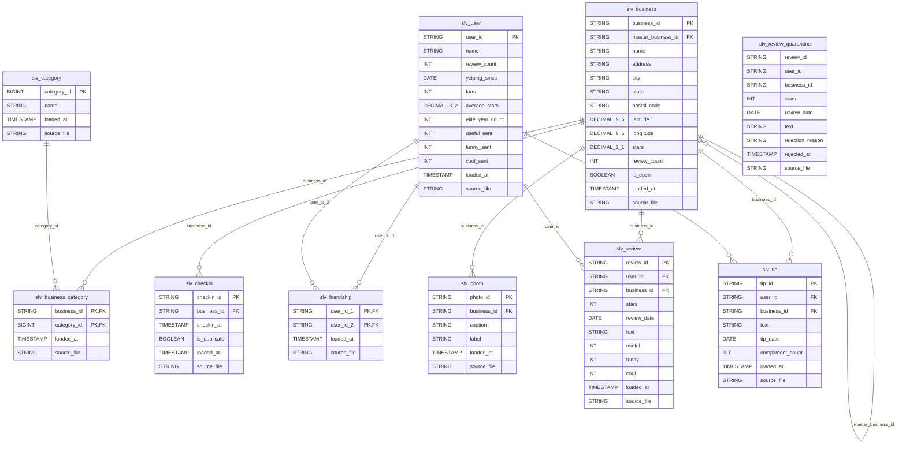

# Modelo lógico (Silver) y modelo dimensional (Gold) — YelpConnect

> **Fuente de verdad:** `02-Modelado/yelp_modelo_logico.drawio` y los scripts `yelp_silver.txt` / `yelp_gold.txt`.
> **Implementación:** `E3_modelo_fisico/01_modelo_fisico_ddl` (DDL), `E7_pipeline_lakehouse/02_silver_limpieza` y `03_gold_productos_datos` (cargas).
> Las tablas y columnas de este documento se generaron desde `workspace.information_schema` de Unity Catalog, por lo que coinciden con lo desplegado.

---

## 1. Decisiones de diseño

| Decisión | Implementación |
| :--- | :--- |
| Silver normalizado (3FN) | Categorías en catálogo propio (`slv_category`) con tabla puente `slv_business_category`; amistades en `slv_friendship` (par guardado una vez, `user_id_1 < user_id_2`). |
| Golden record de negocios | `slv_business.master_business_id` agrupa registros del mismo negocio físico (nombre + dirección + código postal normalizados). Gold publica solo el negocio maestro (DQ-012). |
| Cuarentena de reseñas | Las reseñas que incumplen DQ-001, DQ-003, DQ-004, DQ-005 o DQ-006 van a `slv_review_quarantine` con `rejection_reason`. Las duplicadas lógicas (DQ-002) quedan en Silver y Gold las marca con `is_valid = false`. |
| Check-ins a grano evento | `slv_checkin` tiene una fila por fecha-hora; `is_duplicate` marca repetidos del mismo negocio y momento (DQ-010). |
| Gold con claves naturales | Las dimensiones usan como clave el identificador de Yelp (`business_key`, `user_key`, `category_key`) y `date_key` (YYYYMMDD). Sin SCD tipo 2: cada dimensión guarda el estado vigente. |
| Categorías en Gold | Puente `gld_bridge_business_category` con `is_primary` (categoría principal: la de más negocios; empate alfabético). |
| Agregados por consumidor | Los KPIs de Producto, Operaciones Comerciales y Trust & Safety viven en tablas `gld_agg_*` con grano declarado en el comentario de cada tabla. |
| PII | `name` de `slv_user` y `gld_dim_user` con máscara dinámica `workspace.yelp_gov.mask_name`; consumo analítico por `vw_user_secure`. |

## 2. Inventario de tablas por capa

### yelp_bronze

| Tabla | Columnas | Descripción |
| :--- | ---: | :--- |
| `brz_business` | 16 | Capa Bronze (fidelidad al origen): catálogo crudo de negocios locales de YelpConnect, incluyendo estructuras anidadas attributes y hours retenidas bajo Schema-on-Read (ADR-07). |
| `brz_checkin` | 4 | Capa Bronze (fidelidad al origen): registros crudos de check-ins por negocio con marcas temporales concatenadas en texto. |
| `brz_review` | 12 | Capa Bronze (ingesta incremental Auto Loader / cloudFiles): flujo transaccional crudo de reseñas y calificaciones emitidas por usuarios. |
| `brz_tip` | 7 | Capa Bronze (fidelidad al origen): recomendaciones breves (tips) crudas emitidas por usuarios sobre establecimientos comerciales. |
| `brz_user` | 24 | Capa Bronze (fidelidad al origen): perfiles crudos de usuarios registrados en YelpConnect, incluyendo lista de amigos concatenada y contadores de cumplidos. |

### yelp_silver

| Tabla | Columnas | Descripción |
| :--- | ---: | :--- |
| `slv_business` | 14 | Maestro de negocios de Philadelphia, tomado del Yelp Open Dataset. Una fila por negocio. |
| `slv_business_category` | 4 | Tabla puente que asocia cada negocio con sus categorías. Una fila por par negocio-categoría. |
| `slv_category` | 4 | Catálogo de categorías de negocio de Yelp (por ejemplo, restaurantes o salones de belleza). Una fila por categoría. |
| `slv_checkin` | 6 | Eventos de check-in en negocios de Philadelphia. Una fila por cada fecha-hora de la lista original. |
| `slv_friendship` | 4 | Tabla puente que registra las amistades entre usuarios. Una fila por amistad (el par se guarda una sola vez, con user_id_1 < user_id_2). |
| `slv_photo` | 6 | Fotos que los usuarios subieron a negocios de Yelp. Una fila por foto. Sin datos en la muestra actual, porque el dataset descargado no incluye photo.json. |
| `slv_review` | 11 | Reseñas escritas por usuarios sobre negocios de Philadelphia. Una fila por reseña. |
| `slv_review_quarantine` | 9 | Reseñas de Bronze que no pasan a slv_review por incumplir una regla de calidad. Una fila por reseña rechazada. Las reseñas duplicadas no se rechazan: quedan en slv_review y Gold las marca como no válidas. |
| `slv_tip` | 8 | Tips (sugerencias cortas) que los usuarios escribieron sobre negocios de Philadelphia. Una fila por tip. |
| `slv_user` | 12 | Maestro de usuarios de Yelp que escribieron reseñas o tips en la muestra de Philadelphia. Una fila por usuario. |

### yelp_gold

| Tabla | Columnas | Descripción |
| :--- | ---: | :--- |
| `gld_agg_business_bayesian_month` | 6 | Calificación bayesiana mensual por negocio, para el ranking de Producto (Andrew Collins). Una fila por negocio y mes. |
| `gld_agg_business_checkin_day` | 4 | Conteo diario oficial de check-ins por negocio, para Operaciones Comerciales (Carla Romero). Una fila por negocio y día con check-ins. |
| `gld_agg_business_month` | 16 | Indicadores mensuales por negocio. Una fila por negocio y mes. |
| `gld_agg_business_week` | 4 | Engagement semanal por negocio. Una fila por negocio y semana. |
| `gld_agg_category_month` | 8 | Indicadores mensuales por categoría principal. Una fila por categoría y mes. |
| `gld_agg_review_health_month` | 5 | Salud mensual de las reseñas: válidas, duplicadas y rechazadas, para Trust & Safety (Rafael Nakamura). Una fila por mes. |
| `gld_agg_user_cohort_month` | 6 | Retención mensual de cohortes de usuarios según su mes de alta, para Producto (Andrew Collins). Una fila por cohorte y mes de actividad. |
| `gld_agg_user_month` | 6 | Actividad mensual por usuario. Una fila por usuario y mes. |
| `gld_bridge_business_category` | 3 | Puente entre negocios y categorías. Una fila por par negocio-categoría. |
| `gld_dim_business` | 7 | Dimensión de negocios de Philadelphia, para análisis. Una fila por negocio maestro (golden record). |
| `gld_dim_category` | 2 | Dimensión de categorías de negocio. Una fila por categoría. |
| `gld_dim_date` | 8 | Dimensión de calendario. Una fila por día. |
| `gld_dim_user` | 6 | Dimensión de usuarios de Yelp, para análisis. Una fila por usuario. |
| `gld_fact_checkin` | 6 | Hechos de check-in. Una fila por check-in. No identifica al usuario. |
| `gld_fact_review` | 11 | Hechos de reseñas. Una fila por reseña publicada. |
| `gld_fact_tip` | 6 | Hechos de tips. Una fila por tip. |
| `gld_review_ai_enriched` | 10 | EX · Muestra gobernada de reseñas enriquecidas con IA (sentimiento, tópico principal y flag de disonancia). Consumidores: Trust & Safety (Rafael Nakamura) y Producto (Andrew Collins - REQ-06). |
| `vw_user_secure` | 6 | E6 · Vista segura de usuarios con enmascaramiento dinámico de PII para consumo analítico |

### yelp_gov

| Tabla | Columnas | Descripción |
| :--- | ---: | :--- |
| `business_glossary` | 12 | E4 · Glosario de términos de negocio cargado desde la plantilla institucional. Una fila por término. |
| `data_dictionary` | 25 | E4 · Diccionario de datos de Silver y Gold (plantilla institucional + catálogo de Unity Catalog). Una fila por columna física. |
| `dq_results` | 7 | E5 · Historial de ejecuciones del motor de calidad (insumo de E7 Quality Gate y E8 Dashboard CDO) |
| `dq_rules` | 8 | E5 · Catálogo gobernado de reglas de calidad de datos |
| `pipeline_run_log` | 5 | Observabilidad del pipeline: volumetría y duración por corrida |
| `raci_matrix` | 7 | E6 · Asignación formal de roles y responsabilidades RACI sobre las entidades de YelpConnect |

## 3. Diagrama entidad-relación (generado desde Unity Catalog)

### 3.1 Silver

### 3.2 Gold

```mermaid
erDiagram
    gld_dim_business ||--o{ gld_agg_business_bayesian_month : "business_key"
    gld_dim_business ||--o{ gld_agg_business_checkin_day : "business_key"
    gld_dim_date ||--o{ gld_agg_business_checkin_day : "date_key"
    gld_dim_business ||--o{ gld_agg_business_month : "business_key"
    gld_dim_business ||--o{ gld_agg_business_week : "business_key"
    gld_dim_category ||--o{ gld_agg_category_month : "category_key"
    gld_dim_user ||--o{ gld_agg_user_month : "user_key"
    gld_dim_business ||--o{ gld_bridge_business_category : "business_key"
    gld_dim_category ||--o{ gld_bridge_business_category : "category_key"
    gld_dim_business ||--o{ gld_fact_checkin : "business_key"
    gld_dim_date ||--o{ gld_fact_checkin : "date_key"
    gld_dim_business ||--o{ gld_fact_review : "business_key"
    gld_dim_date ||--o{ gld_fact_review : "date_key"
    gld_dim_user ||--o{ gld_fact_review : "user_key"
    gld_dim_business ||--o{ gld_fact_tip : "business_key"
    gld_dim_date ||--o{ gld_fact_tip : "date_key"
    gld_dim_user ||--o{ gld_fact_tip : "user_key"
    gld_agg_business_bayesian_month {
        STRING business_key PK, FK
        INT period_month PK
        INT valid_review_count
        DECIMAL_3_2 valid_rating
        DECIMAL_3_2 bayesian_rating
        INT review_author_count
    }
    gld_agg_business_checkin_day {
        STRING business_key PK, FK
        INT date_key PK, FK
        INT checkin_count
        INT active_hour_count
    }
    gld_agg_business_month {
        STRING business_key PK, FK
        INT period_month PK
        INT review_count
        DECIMAL_3_2 avg_review_stars
        INT review_author_count
        INT checkin_count
        INT tip_count
        INT interaction_count
        INT valid_review_count
        DECIMAL_3_2 valid_rating
        DECIMAL_5_4 useful_review_rate
        INT days_since_last_review
        DECIMAL_3_2 rating_gap
        DECIMAL_5_4 negative_review_rate
        DECIMAL_5_4 invalid_content_rate
        TIMESTAMP calculated_at
    }
    gld_agg_business_week {
        STRING business_key PK, FK
        DATE week_start PK
        INT checkin_count
        INT tip_count
    }
    gld_agg_category_month {
        BIGINT category_key PK, FK
        INT period_month PK
        INT business_count
        INT review_count
        INT checkin_count
        DECIMAL_3_2 avg_review_stars
        DECIMAL_3_2 valid_rating
        INT negative_review_count
    }
    gld_agg_review_health_month {
        INT period_month PK
        INT valid_review_count
        INT invalid_review_count
        INT quarantined_review_count
        DECIMAL_5_4 quarantine_rate
    }
    gld_agg_user_cohort_month {
        INT cohort_month PK
        INT activity_month PK
        INT months_since_join
        INT cohort_size
        INT active_user_count
        DECIMAL_5_4 retention_rate
    }
    gld_agg_user_month {
        STRING user_key PK, FK
        INT period_month PK
        INT review_count
        INT tip_count
        INT contribution_count
        BOOLEAN is_contributor
    }
    gld_bridge_business_category {
        STRING business_key PK, FK
        BIGINT category_key PK, FK
        BOOLEAN is_primary
    }
    gld_dim_business {
        STRING business_key PK
        STRING name
        STRING city
        STRING state
        STRING primary_category
        DECIMAL_2_1 declared_stars
        BOOLEAN is_open
    }
    gld_dim_category {
        BIGINT category_key PK
        STRING name
    }
    gld_dim_date {
        INT date_key PK
        DATE full_date
        INT year
        INT month
        STRING month_name
        INT quarter
        DATE week_start
        DATE month_start
    }
    gld_dim_user {
        STRING user_key PK
        STRING name
        DATE yelping_since
        INT fans
        DECIMAL_3_2 avg_stars
        BOOLEAN is_elite
    }
    gld_fact_checkin {
        STRING checkin_id PK
        STRING business_key FK
        INT date_key FK
        INT checkin_hour
        BOOLEAN is_duplicate
        TIMESTAMP loaded_at
    }
    gld_fact_review {
        STRING review_id PK
        STRING business_key FK
        STRING user_key FK
        INT date_key FK
        INT stars
        INT useful
        INT funny
        INT cool
        TIMESTAMP loaded_at
        BOOLEAN is_valid
        STRING invalid_reason
    }
    gld_fact_tip {
        STRING tip_id PK
        STRING user_key FK
        STRING business_key FK
        INT date_key FK
        INT compliment_count
        TIMESTAMP loaded_at
    }
    gld_review_ai_enriched {
        STRING review_id
        STRING business_key
        STRING user_key
        INT stars
        DATE review_date
        STRING text
        STRING sentiment
        STRING topic
        STRING ai_consistency_status
        TIMESTAMP inferred_at
    }
```

## 4. Detalle de columnas

### `yelp_silver.slv_business`

| Columna | Tipo | Nulo | Clave | Descripción |
| :--- | :--- | :---: | :---: | :--- |
| `business_id` | string | No | PK | Identificador único del negocio asignado por Yelp |
| `master_business_id` | string | No | FK → slv_business.business_id | Negocio maestro (golden record): business_id del registro sobreviviente entre los que representan el mismo negocio físico. Es el mismo business_id si el negocio no tiene duplicados |
| `name` | string | No |  | Nombre comercial del negocio |
| `address` | string | Sí |  | Dirección postal del negocio |
| `city` | string | Sí |  | Ciudad donde se ubica el negocio |
| `state` | string | Sí |  | Estado donde se ubica el negocio (código de 2 letras) |
| `postal_code` | string | Sí |  | Código postal del negocio |
| `latitude` | decimal(9,6) | Sí |  | Latitud geográfica del negocio |
| `longitude` | decimal(9,6) | Sí |  | Longitud geográfica del negocio |
| `stars` | decimal(2,1) | Sí |  | Calificación promedio declarada por Yelp, de 1 a 5 en pasos de media estrella |
| `review_count` | int | Sí |  | Cantidad total de reseñas declarada por Yelp para el negocio |
| `is_open` | boolean | Sí |  | Indica si el negocio sigue abierto (true) o cerró (false) |
| `loaded_at` | timestamp | No |  | Momento en que la fila se cargó desde Bronze |
| `source_file` | string | Sí |  | Archivo de Bronze del que proviene la fila |

### `yelp_silver.slv_business_category`

| Columna | Tipo | Nulo | Clave | Descripción |
| :--- | :--- | :---: | :---: | :--- |
| `business_id` | string | No | PK, FK → slv_business.business_id | Negocio asociado a la categoría |
| `category_id` | bigint | No | PK, FK → slv_category.category_id | Categoría asignada al negocio |
| `loaded_at` | timestamp | No |  | Momento en que la fila se cargó desde Bronze |
| `source_file` | string | Sí |  | Archivo de Bronze del que proviene la fila |

### `yelp_silver.slv_category`

| Columna | Tipo | Nulo | Clave | Descripción |
| :--- | :--- | :---: | :---: | :--- |
| `category_id` | bigint | No | PK | Identificador único de la categoría, generado en el proceso de carga |
| `name` | string | No |  | Nombre de la categoría tal como aparece en Yelp |
| `loaded_at` | timestamp | No |  | Momento en que la fila se cargó desde Bronze |
| `source_file` | string | Sí |  | Archivo de Bronze del que proviene la fila |

### `yelp_silver.slv_checkin`

| Columna | Tipo | Nulo | Clave | Descripción |
| :--- | :--- | :---: | :---: | :--- |
| `checkin_id` | string | No | PK | Identificador determinístico del check-in: hash de business_id, checkin_at y posición en la lista original de checkin.date |
| `business_id` | string | No | FK → slv_business.business_id | Negocio donde se registró el check-in |
| `checkin_at` | timestamp | No |  | Fecha y hora en que se registró el check-in |
| `is_duplicate` | boolean | No |  | Verdadero si ya existe otro check-in del mismo negocio con la misma fecha y hora (DQ-010). Los duplicados no cuentan en las métricas |
| `loaded_at` | timestamp | No |  | Momento en que la fila se cargó desde Bronze |
| `source_file` | string | Sí |  | Archivo de Bronze del que proviene la fila |

### `yelp_silver.slv_friendship`

| Columna | Tipo | Nulo | Clave | Descripción |
| :--- | :--- | :---: | :---: | :--- |
| `user_id_1` | string | No | PK, FK → slv_user.user_id | Usuario de la amistad con el identificador menor |
| `user_id_2` | string | No | PK, FK → slv_user.user_id | Usuario de la amistad con el identificador mayor |
| `loaded_at` | timestamp | No |  | Momento en que la fila se cargó desde Bronze |
| `source_file` | string | Sí |  | Archivo de Bronze del que proviene la fila |

### `yelp_silver.slv_photo`

| Columna | Tipo | Nulo | Clave | Descripción |
| :--- | :--- | :---: | :---: | :--- |
| `photo_id` | string | No | PK | Identificador único de la foto asignado por Yelp |
| `business_id` | string | No | FK → slv_business.business_id | Negocio al que pertenece la foto |
| `caption` | string | Sí |  | Descripción escrita por el usuario para la foto |
| `label` | string | Sí |  | Tipo de foto (comida, bebida, menú, interior o exterior) |
| `loaded_at` | timestamp | No |  | Momento en que la fila se cargó desde Bronze |
| `source_file` | string | Sí |  | Archivo de Bronze del que proviene la fila |

### `yelp_silver.slv_review`

| Columna | Tipo | Nulo | Clave | Descripción |
| :--- | :--- | :---: | :---: | :--- |
| `review_id` | string | No | PK | Identificador único de la reseña asignado por Yelp |
| `user_id` | string | No | FK → slv_user.user_id | Usuario que escribió la reseña |
| `business_id` | string | No | FK → slv_business.business_id | Negocio sobre el que trata la reseña |
| `stars` | int | No |  | Calificación dada en la reseña, de 1 a 5 estrellas |
| `review_date` | date | No |  | Fecha en que se publicó la reseña |
| `text` | string | Sí |  | Texto completo de la reseña |
| `useful` | int | Sí |  | Votos "útil" recibidos por la reseña |
| `funny` | int | Sí |  | Votos "divertido" recibidos por la reseña |
| `cool` | int | Sí |  | Votos "genial" recibidos por la reseña |
| `loaded_at` | timestamp | No |  | Momento en que la fila se cargó desde Bronze |
| `source_file` | string | Sí |  | Archivo de Bronze del que proviene la fila |

### `yelp_silver.slv_review_quarantine`

| Columna | Tipo | Nulo | Clave | Descripción |
| :--- | :--- | :---: | :---: | :--- |
| `review_id` | string | Sí |  | Identificador de la reseña rechazada |
| `user_id` | string | Sí |  | Usuario reportado en la reseña rechazada |
| `business_id` | string | Sí |  | Negocio reportado en la reseña rechazada |
| `stars` | int | Sí |  | Calificación original de la reseña rechazada |
| `review_date` | date | Sí |  | Fecha original de la reseña rechazada |
| `text` | string | Sí |  | Texto original de la reseña, retenido para auditoría de Trust & Safety |
| `rejection_reason` | string | No |  | Regla de calidad incumplida (por ejemplo, autor inexistente o estrellas fuera de rango) |
| `rejected_at` | timestamp | No |  | Momento en que el pipeline rechazó la reseña |
| `source_file` | string | Sí |  | Archivo de Bronze del que proviene la fila |

### `yelp_silver.slv_tip`

| Columna | Tipo | Nulo | Clave | Descripción |
| :--- | :--- | :---: | :---: | :--- |
| `tip_id` | string | No | PK | Identificador determinístico del tip: hash de user_id, business_id, tip_date y text |
| `user_id` | string | No | FK → slv_user.user_id | Usuario que escribió el tip |
| `business_id` | string | No | FK → slv_business.business_id | Negocio sobre el que trata el tip |
| `text` | string | Sí |  | Texto del tip |
| `tip_date` | date | No |  | Fecha en que se escribió el tip |
| `compliment_count` | int | Sí |  | Cantidad de cumplidos recibidos por el tip |
| `loaded_at` | timestamp | No |  | Momento en que la fila se cargó desde Bronze |
| `source_file` | string | Sí |  | Archivo de Bronze del que proviene la fila |

### `yelp_silver.slv_user`

| Columna | Tipo | Nulo | Clave | Descripción |
| :--- | :--- | :---: | :---: | :--- |
| `user_id` | string | No | PK | Identificador único del usuario asignado por Yelp |
| `name` | string | No |  | Nombre de pila del usuario (dato personal, enmascarado en E6) |
| `review_count` | int | Sí |  | Cantidad total de reseñas escritas por el usuario |
| `yelping_since` | date | Sí |  | Fecha en que el usuario se unió a Yelp |
| `fans` | int | Sí |  | Cantidad de seguidores (fans) del usuario |
| `average_stars` | decimal(3,2) | Sí |  | Calificación promedio que el usuario da en sus reseñas |
| `elite_year_count` | int | Sí |  | Cantidad de años en que Yelp reconoció al usuario como Elite (0 si nunca lo fue) |
| `useful_sent` | int | Sí |  | Votos "útil" que el usuario ha dado a reseñas de otros |
| `funny_sent` | int | Sí |  | Votos "divertido" que el usuario ha dado a reseñas de otros |
| `cool_sent` | int | Sí |  | Votos "genial" que el usuario ha dado a reseñas de otros |
| `loaded_at` | timestamp | No |  | Momento en que la fila se cargó desde Bronze |
| `source_file` | string | Sí |  | Archivo de Bronze del que proviene la fila |

### `yelp_gold.gld_agg_business_bayesian_month`

| Columna | Tipo | Nulo | Clave | Descripción |
| :--- | :--- | :---: | :---: | :--- |
| `business_key` | string | No | PK, FK → gld_dim_business.business_key | Negocio al que corresponde el corte mensual |
| `period_month` | int | No | PK | Mes del indicador en formato AAAAMM |
| `valid_review_count` | int | Sí |  | Cantidad de reseñas válidas del negocio en el mes |
| `valid_rating` | decimal(3,2) | Sí |  | Promedio simple de estrellas de las reseñas válidas del negocio en el mes |
| `bayesian_rating` | decimal(3,2) | Sí |  | Calificación bayesiana: pondera valid_rating con el promedio de la ciudad usando m = 25 reseñas, para que los negocios con pocas reseñas no queden arriba del ranking |
| `review_author_count` | int | Sí |  | Autores únicos de reseñas válidas del negocio en el mes |

### `yelp_gold.gld_agg_business_checkin_day`

| Columna | Tipo | Nulo | Clave | Descripción |
| :--- | :--- | :---: | :---: | :--- |
| `business_key` | string | No | PK, FK → gld_dim_business.business_key | Negocio visitado |
| `date_key` | int | No | PK, FK → gld_dim_date.date_key | Fecha de las visitas en formato AAAAMMDD |
| `checkin_count` | int | Sí |  | Cantidad de check-ins no duplicados del negocio en el día |
| `active_hour_count` | int | Sí |  | Cantidad de horas distintas del día con al menos un check-in (conteo homologado de afluencia por ventana de 60 minutos) |

### `yelp_gold.gld_agg_business_month`

| Columna | Tipo | Nulo | Clave | Descripción |
| :--- | :--- | :---: | :---: | :--- |
| `business_key` | string | No | PK, FK → gld_dim_business.business_key | Negocio al que corresponde el corte mensual |
| `period_month` | int | No | PK | Mes del indicador en formato AAAAMM |
| `review_count` | int | Sí |  | Cantidad mensual de reseñas del negocio |
| `avg_review_stars` | decimal(3,2) | Sí |  | Calificación promedio mensual de todas las reseñas publicadas |
| `review_author_count` | int | Sí |  | Autores únicos de reseñas del negocio en el mes |
| `checkin_count` | int | Sí |  | Cantidad mensual de check-ins |
| `tip_count` | int | Sí |  | Cantidad mensual de tips |
| `interaction_count` | int | Sí |  | Reseñas, check-ins y tips del mes (eventos, no usuarios) |
| `valid_review_count` | int | Sí |  | Cantidad de reseñas válidas del negocio en el mes |
| `valid_rating` | decimal(3,2) | Sí |  | Promedio de estrellas de las reseñas válidas del negocio en el mes |
| `useful_review_rate` | decimal(5,4) | Sí |  | Proporción de reseñas válidas con al menos un voto útil |
| `days_since_last_review` | int | Sí |  | Días entre la última reseña válida y el cierre del mes |
| `rating_gap` | decimal(3,2) | Sí |  | Diferencia entre la calificación declarada (declared_stars de gld_dim_business) y la calificación válida |
| `negative_review_rate` | decimal(5,4) | Sí |  | Proporción de reseñas válidas de 1 o 2 estrellas |
| `invalid_content_rate` | decimal(5,4) | Sí |  | Proporción de reseñas no válidas sobre el total de reseñas del mes |
| `calculated_at` | timestamp | Sí |  | Momento en que se calculó el indicador |

### `yelp_gold.gld_agg_business_week`

| Columna | Tipo | Nulo | Clave | Descripción |
| :--- | :--- | :---: | :---: | :--- |
| `business_key` | string | No | PK, FK → gld_dim_business.business_key | Negocio al que corresponde el corte semanal |
| `week_start` | date | No | PK | Lunes de la semana del indicador |
| `checkin_count` | int | Sí |  | Cantidad de check-ins únicos del negocio en la semana |
| `tip_count` | int | Sí |  | Cantidad de tips del negocio en la semana |

### `yelp_gold.gld_agg_category_month`

| Columna | Tipo | Nulo | Clave | Descripción |
| :--- | :--- | :---: | :---: | :--- |
| `category_key` | bigint | No | PK, FK → gld_dim_category.category_key | Categoría principal (is_primary = true en el puente) a la que corresponde el corte |
| `period_month` | int | No | PK | Mes del indicador en formato AAAAMM |
| `business_count` | int | Sí |  | Cantidad de negocios de la categoría |
| `review_count` | int | Sí |  | Cantidad de reseñas de los negocios de la categoría en el mes |
| `checkin_count` | int | Sí |  | Cantidad de check-ins de los negocios de la categoría en el mes |
| `avg_review_stars` | decimal(3,2) | Sí |  | Calificación promedio de todas las reseñas de la categoría en el mes |
| `valid_rating` | decimal(3,2) | Sí |  | Promedio de estrellas de las reseñas válidas de la categoría en el mes |
| `negative_review_count` | int | Sí |  | Reseñas válidas de 1 o 2 estrellas de la categoría en el mes |

### `yelp_gold.gld_agg_review_health_month`

| Columna | Tipo | Nulo | Clave | Descripción |
| :--- | :--- | :---: | :---: | :--- |
| `period_month` | int | No | PK | Mes de publicación de las reseñas en formato AAAAMM |
| `valid_review_count` | int | Sí |  | Reseñas válidas del mes (en Silver y no duplicadas) |
| `invalid_review_count` | int | Sí |  | Reseñas del mes marcadas como no válidas por duplicado |
| `quarantined_review_count` | int | Sí |  | Reseñas del mes rechazadas en slv_review_quarantine |
| `quarantine_rate` | decimal(5,4) | Sí |  | Proporción de reseñas rechazadas sobre el total de reseñas recibidas en el mes |

### `yelp_gold.gld_agg_user_cohort_month`

| Columna | Tipo | Nulo | Clave | Descripción |
| :--- | :--- | :---: | :---: | :--- |
| `cohort_month` | int | No | PK | Mes en que los usuarios se unieron a Yelp, en formato AAAAMM |
| `activity_month` | int | No | PK | Mes de actividad de la cohorte, en formato AAAAMM |
| `months_since_join` | int | Sí |  | Meses transcurridos entre cohort_month y activity_month |
| `cohort_size` | int | Sí |  | Cantidad de usuarios de la cohorte |
| `active_user_count` | int | Sí |  | Usuarios de la cohorte que publicaron al menos una reseña válida en el mes |
| `retention_rate` | decimal(5,4) | Sí |  | Proporción de usuarios de la cohorte activos en el mes |

### `yelp_gold.gld_agg_user_month`

| Columna | Tipo | Nulo | Clave | Descripción |
| :--- | :--- | :---: | :---: | :--- |
| `user_key` | string | No | PK, FK → gld_dim_user.user_key | Usuario al que corresponde el corte mensual |
| `period_month` | int | No | PK | Mes de la actividad en formato AAAAMM |
| `review_count` | int | Sí |  | Reseñas publicadas por el usuario en el mes |
| `tip_count` | int | Sí |  | Tips publicados por el usuario en el mes |
| `contribution_count` | int | Sí |  | Reseñas y tips del usuario en el mes |
| `is_contributor` | boolean | Sí |  | Verdadero si el usuario publicó al menos una reseña o tip en el mes |

### `yelp_gold.gld_bridge_business_category`

| Columna | Tipo | Nulo | Clave | Descripción |
| :--- | :--- | :---: | :---: | :--- |
| `business_key` | string | No | PK, FK → gld_dim_business.business_key | Negocio al que se asigna la categoría |
| `category_key` | bigint | No | PK, FK → gld_dim_category.category_key | Categoría asignada al negocio |
| `is_primary` | boolean | No |  | Indica si es la categoría principal del negocio (la de más negocios en la muestra; en empate, la primera en orden alfabético) |

### `yelp_gold.gld_dim_business`

| Columna | Tipo | Nulo | Clave | Descripción |
| :--- | :--- | :---: | :---: | :--- |
| `business_key` | string | No | PK | Identificador del negocio maestro (master_business_id de slv_business) |
| `name` | string | No |  | Nombre comercial del negocio |
| `city` | string | Sí |  | Ciudad del negocio |
| `state` | string | Sí |  | Estado del negocio |
| `primary_category` | string | Sí |  | Nombre de la categoría principal del negocio: la marcada con is_primary en gld_bridge_business_category |
| `declared_stars` | decimal(2,1) | Sí |  | Calificación declarada por Yelp para el negocio (stars de slv_business). Se compara con la calificación válida en rating_gap |
| `is_open` | boolean | Sí |  | Indica si el negocio sigue abierto |

### `yelp_gold.gld_dim_category`

| Columna | Tipo | Nulo | Clave | Descripción |
| :--- | :--- | :---: | :---: | :--- |
| `category_key` | bigint | No | PK | Identificador único de la categoría de negocio (category_id de slv_category) |
| `name` | string | No |  | Nombre de la categoría de negocio, único y normalizado |

### `yelp_gold.gld_dim_date`

| Columna | Tipo | Nulo | Clave | Descripción |
| :--- | :--- | :---: | :---: | :--- |
| `date_key` | int | No | PK | Clave de la fecha en formato AAAAMMDD |
| `full_date` | date | No |  | Fecha calendario |
| `year` | int | No |  | Año de la fecha |
| `month` | int | No |  | Número de mes (1 a 12) |
| `month_name` | string | No |  | Nombre del mes |
| `quarter` | int | No |  | Trimestre del año (1 a 4) |
| `week_start` | date | Sí |  | Lunes de la semana a la que pertenece la fecha |
| `month_start` | date | Sí |  | Primer día del mes al que pertenece la fecha |

### `yelp_gold.gld_dim_user`

| Columna | Tipo | Nulo | Clave | Descripción |
| :--- | :--- | :---: | :---: | :--- |
| `user_key` | string | No | PK | Identificador del usuario (user_id de Yelp) |
| `name` | string | No |  | Nombre de pila del usuario (dato personal, enmascarado en E6) |
| `yelping_since` | date | Sí |  | Fecha en que el usuario se unió a Yelp |
| `fans` | int | Sí |  | Cantidad de seguidores del usuario |
| `avg_stars` | decimal(3,2) | Sí |  | Calificación promedio que da el usuario |
| `is_elite` | boolean | Sí |  | Verdadero si Yelp reconoció al usuario como Elite en al menos un año |

### `yelp_gold.gld_fact_checkin`

| Columna | Tipo | Nulo | Clave | Descripción |
| :--- | :--- | :---: | :---: | :--- |
| `checkin_id` | string | No | PK | Identificador determinístico del check-in (el mismo de slv_checkin) |
| `business_key` | string | No | FK → gld_dim_business.business_key | Negocio maestro visitado |
| `date_key` | int | No | FK → gld_dim_date.date_key | Fecha del check-in en formato AAAAMMDD |
| `checkin_hour` | int | Sí |  | Hora del check-in, de 0 a 23 |
| `is_duplicate` | boolean | No |  | Verdadero si es un check-in duplicado (DQ-010). Los duplicados no cuentan en las métricas |
| `loaded_at` | timestamp | No |  | Momento de la carga de Silver de la que proviene la fila |

### `yelp_gold.gld_fact_review`

| Columna | Tipo | Nulo | Clave | Descripción |
| :--- | :--- | :---: | :---: | :--- |
| `review_id` | string | No | PK | Identificador único de la reseña |
| `business_key` | string | No | FK → gld_dim_business.business_key | Negocio maestro reseñado |
| `user_key` | string | No | FK → gld_dim_user.user_key | Usuario que escribió la reseña |
| `date_key` | int | No | FK → gld_dim_date.date_key | Fecha de publicación de la reseña |
| `stars` | int | No |  | Calificación de 1 a 5 estrellas |
| `useful` | int | Sí |  | Votos "útil" recibidos |
| `funny` | int | Sí |  | Votos "divertido" recibidos |
| `cool` | int | Sí |  | Votos "genial" recibidos |
| `loaded_at` | timestamp | No |  | Momento de la carga de Silver de la que proviene la fila |
| `is_valid` | boolean | Sí |  | Indica si la reseña es válida (no está duplicada). Solo las reseñas válidas cuentan en las métricas oficiales |
| `invalid_reason` | string | Sí |  | Motivo por el que la reseña no es válida (duplicada). Vacío si la reseña es válida |

### `yelp_gold.gld_fact_tip`

| Columna | Tipo | Nulo | Clave | Descripción |
| :--- | :--- | :---: | :---: | :--- |
| `tip_id` | string | No | PK | Identificador determinístico del tip (el mismo de slv_tip) |
| `user_key` | string | No | FK → gld_dim_user.user_key | Usuario que escribió el tip |
| `business_key` | string | No | FK → gld_dim_business.business_key | Negocio maestro que recibió el tip |
| `date_key` | int | No | FK → gld_dim_date.date_key | Fecha de publicación del tip en formato AAAAMMDD |
| `compliment_count` | int | Sí |  | Cantidad de cumplidos recibidos por el tip |
| `loaded_at` | timestamp | No |  | Momento de la carga de Silver de la que proviene la fila |

### `yelp_gold.gld_review_ai_enriched`

| Columna | Tipo | Nulo | Clave | Descripción |
| :--- | :--- | :---: | :---: | :--- |
| `review_id` | string | Sí |  | Identificador único de la reseña analizada (FK hacia gld_fact_review) |
| `business_key` | string | Sí |  | Negocio maestro evaluado (FK hacia gld_dim_business) |
| `user_key` | string | Sí |  | Autor de la reseña (FK hacia gld_dim_user) |
| `stars` | int | Sí |  | Calificación numérica otorgada por el usuario (1 a 5 estrellas) |
| `review_date` | date | Sí |  | Marca temporal de publicación de la reseña |
| `text` | string | Sí |  | Texto de la reseña truncado a 1,000 caracteres para control FinOps de inferencia |
| `sentiment` | string | Sí |  | Sentimiento inferido por ai_analyze_sentiment (positive, negative, neutral, mixed) |
| `topic` | string | Sí |  | Categoría temática inferida por ai_classify (comida, servicio, precio, ambiente, otro) |
| `ai_consistency_status` | string | Sí |  | Clasificación de consistencia entre stars y sentimiento para auditoría de Trust & Safety |
| `inferred_at` | timestamp | Sí |  | Timestamp de ejecución del modelo fundacional sobre la muestra |

### `yelp_gold.vw_user_secure`

| Columna | Tipo | Nulo | Clave | Descripción |
| :--- | :--- | :---: | :---: | :--- |
| `user_key` | string | No |  | Identificador del usuario (user_id de Yelp) |
| `masked_name` | string | No |  | Nombre del usuario enmascarado según el rol de quien consulta |
| `yelping_since` | date | Sí |  | Fecha en que el usuario se unió a Yelp |
| `fans` | int | Sí |  | Cantidad de seguidores del usuario |
| `avg_stars` | decimal(3,2) | Sí |  | Calificación promedio que da el usuario |
| `is_elite` | boolean | Sí |  | Verdadero si Yelp reconoció al usuario como Elite en al menos un año |

### `yelp_gov.business_glossary`

| Columna | Tipo | Nulo | Clave | Descripción |
| :--- | :--- | :---: | :---: | :--- |
| `term` | string | Sí |  | Nombre del término: nombre oficial aprobado del concepto |
| `synonyms` | string | Sí |  | Sinónimos o alias con que también se conoce el término |
| `business_definition` | string | Sí |  | Definición de negocio, comprensible sin tecnicismos |
| `technical_definition` | string | Sí |  | Definición técnica: cómo se representa en la plataforma |
| `usage_context` | string | Sí |  | Áreas, procesos o dominios donde se usa el término |
| `data_domain` | string | Sí |  | Dominio de datos al que pertenece el término |
| `category` | string | Sí |  | Categoría: entidad, atributo, rol, proceso, medida, indicador o concepto |
| `usage_example` | string | Sí |  | Frase que ilustra el término aplicado al caso |
| `related_terms` | string | Sí |  | Relaciones con otros términos del glosario |
| `term_owner` | string | Sí |  | Data Owner responsable de la definición |
| `regulatory_source` | string | Sí |  | Ley, norma o política interna que respalda la definición |
| `updated_at` | date | Sí |  | Fecha de creación o última actualización del término |

### `yelp_gov.data_dictionary`

| Columna | Tipo | Nulo | Clave | Descripción |
| :--- | :--- | :---: | :---: | :--- |
| `element` | string | Sí |  | Nombre técnico del campo |
| `business_name` | string | Sí |  | Nombre de negocio usado en el glosario |
| `business_description` | string | Sí |  | Significado del dato para el negocio |
| `domain` | string | Sí |  | Dominio o tema de datos |
| `source_system` | string | Sí |  | Sistema o aplicación donde se origina el dato |
| `physical_name` | string | Sí |  | Nombre calificado en Unity Catalog (catalogo.schema.tabla.columna) |
| `data_type` | string | Sí |  | Tipo de dato según el motor |
| `format` | string | Sí |  | Formato o patrón esperado |
| `length` | string | Sí |  | Longitud o precisión |
| `allowed_values` | string | Sí |  | Valores permitidos o dominio de valores |
| `unit_of_measure` | string | Sí |  | Unidad de medida, si aplica |
| `default_value` | string | Sí |  | Valor por defecto |
| `nullability` | string | Sí |  | Obligatorio u opcional |
| `key_type` | string | Sí |  | Clave primaria o foránea |
| `quality_rules` | string | Sí |  | Reglas de calidad aplicables; cita identificadores DQ-nnn de yelp_gov.dq_rules |
| `transformation_rules` | string | Sí |  | Reglas de transformación o cálculo, si aplica |
| `update_frequency` | string | Sí |  | Frecuencia de actualización |
| `data_origin` | string | Sí |  | Cómo y desde dónde se genera el dato |
| `process_usage` | string | Sí |  | Usos o procesos relacionados |
| `related_elements` | string | Sí |  | Relación con otros elementos de datos |
| `data_owner` | string | Sí |  | Responsable o Data Owner |
| `retention_policy` | string | Sí |  | Política de retención |
| `sensitivity` | string | Sí |  | Sensibilidad o clasificación: Público, Interno, Confidencial o Restringido |
| `regulatory_source` | string | Sí |  | Fuente normativa o regulatoria |
| `updated_at` | date | Sí |  | Fecha de creación o última actualización de la entrada |

### `yelp_gov.dq_results`

| Columna | Tipo | Nulo | Clave | Descripción |
| :--- | :--- | :---: | :---: | :--- |
| `executed_at` | timestamp | Sí |  | Marca temporal exacta de la corrida del motor DQ |
| `rule_id` | string | Sí |  | Identificador de la regla evaluada (FK hacia dq_rules) |
| `target_table` | string | Sí |  | Tabla física evaluada en workspace.yelp_silver |
| `total_rows` | bigint | Sí |  | Total de registros evaluados en la tabla |
| `passed_rows` | bigint | Sí |  | Total de registros que cumplen satisfactoriamente la regla |
| `compliance_pct` | double | Sí |  | Porcentaje de cumplimiento (0.00 a 100.00) |
| `passed` | boolean | Sí |  | TRUE si compliance_pct >= threshold_pct de la regla |

### `yelp_gov.dq_rules`

| Columna | Tipo | Nulo | Clave | Descripción |
| :--- | :--- | :---: | :---: | :--- |
| `rule_id` | string | Sí |  | Identificador único (DQ-001 a DQ-015) |
| `target_table` | string | Sí |  | Tabla física evaluada en workspace.yelp_silver |
| `column_name` | string | Sí |  | Columna evaluada (o * si es a nivel tabla) |
| `dimension` | string | Sí |  | Dimensión DQ: validity/uniqueness/completeness/consistency/accuracy/timeliness |
| `description` | string | Sí |  | Regla en lenguaje de negocio aprobada por el Data Owner |
| `sql_expression` | string | Sí |  | Predicado SQL que DEBE cumplirse sobre la tabla objetivo |
| `criticality` | string | Sí |  | critical/high/medium — las reglas critical actúan como Quality Gate en E7 |
| `threshold_pct` | double | Sí |  | Porcentaje mínimo de filas que deben cumplir la regla (0.0 a 100.0) |

### `yelp_gov.pipeline_run_log`

| Columna | Tipo | Nulo | Clave | Descripción |
| :--- | :--- | :---: | :---: | :--- |
| `executed_at` | timestamp | Sí |  | Momento del registro |
| `layer` | string | Sí |  | Capa medallón (bronze, silver, gold) |
| `table_name` | string | Sí |  | Tabla procesada |
| `row_count` | bigint | Sí |  | Filas resultantes en la tabla |
| `duration_sec` | double | Sí |  | Duración en segundos de la etapa |

### `yelp_gov.raci_matrix`

| Columna | Tipo | Nulo | Clave | Descripción |
| :--- | :--- | :---: | :---: | :--- |
| `entity` | string | Sí |  | Entidad conceptual y lógica gobernada del caso YelpConnect |
| `domain` | string | Sí |  | Dominio de datos DAMA-DMBOK al que pertenece la entidad |
| `data_owner` | string | Sí |  | Accountable (A) — Ejecutivo dueño de negocio responsable del dato |
| `data_steward` | string | Sí |  | Responsible (R) — Custodio funcional que opera calidad y metadatos |
| `data_custodian` | string | Sí |  | Responsible técnico — Equipo Data Platform que opera el Lakehouse |
| `consumers` | string | Sí |  | Informed / Consulted — Áreas de negocio autorizadas a consumir |
| `classification` | string | Sí |  | Nivel de sensibilidad: public / internal / confidential / pii |

### `yelp_bronze.brz_business`

| Columna | Tipo | Nulo | Clave | Descripción |
| :--- | :--- | :---: | :---: | :--- |
| `address` | string | Sí |  | Dirección postal en texto libre del establecimiento |
| `attributes` | struct<AcceptsInsurance:string,AgesAllowed:string,Alcohol:string,Ambience:string,BYOB:string,BYOBCorkage:string,BestNights:string,BikeParking:string,BusinessAcceptsBitcoin:string,BusinessAcceptsCreditCards:string,BusinessParking:string,ByAppointmentOnly:string,Caters:string,CoatCheck:string,Corkage:string,DietaryRestrictions:string,DogsAllowed:string,DriveThru:string,GoodForDancing:string,GoodForKids:string,GoodForMeal:string,HairSpecializesIn:string,HappyHour:string,HasTV:string,Music:string,NoiseLevel:string,Open24Hours:string,OutdoorSeating:string,RestaurantsAttire:string,RestaurantsCounterService:string,RestaurantsDelivery:string,RestaurantsGoodForGroups:string,RestaurantsPriceRange2:string,RestaurantsReservations:string,RestaurantsTableService:string,RestaurantsTakeOut:string,Smoking:string,WheelchairAccessible:string,WiFi:string> | Sí |  | Objeto STRUCT anidado con 39 subcampos opcionales de características del negocio retenido en Bronze bajo Schema-on-Read (ADR-07) |
| `business_id` | string | Sí |  | Identificador natural único del negocio en el archivo JSON crudo (22 caracteres) |
| `categories` | string | Sí |  | Cadena de texto con las categorías del negocio separadas por comas (se normaliza en Silver en slv_category y la tabla puente slv_business_category) |
| `city` | string | Sí |  | Ciudad del establecimiento sin normalizar |
| `hours` | struct<Friday:string,Monday:string,Saturday:string,Sunday:string,Thursday:string,Tuesday:string,Wednesday:string> | Sí |  | Objeto STRUCT anidado con los horarios de atención por día de la semana (Monday a Sunday) retenido en Bronze (ADR-07) |
| `is_open` | bigint | Sí |  | Indicador crudo de apertura en formato entero (1 = abierto, 0 = cerrado) |
| `latitude` | double | Sí |  | Latitud geográfica cruda del negocio |
| `longitude` | double | Sí |  | Longitud geográfica cruda del negocio |
| `name` | string | Sí |  | Nombre comercial tal como llega del sistema fuente |
| `postal_code` | string | Sí |  | Código postal o ZIP en formato texto |
| `review_count` | bigint | Sí |  | Conteo bruto acumulado de reseñas en el origen |
| `stars` | double | Sí |  | Calificación promedio publicada en la ficha del negocio (incrementos de 0.5) |
| `state` | string | Sí |  | Código de estado o provincia sin normalizar |
| `_source_file` | string | Sí |  | Ruta física del archivo .json/.json.gz de origen en el Volume (/Volumes/workspace/yelp_bronze/raw/) |
| `_ingested_at` | timestamp | Sí |  | Timestamp exacto de ingesta del registro hacia la capa Bronze (auditoría técnica) |

### `yelp_bronze.brz_checkin`

| Columna | Tipo | Nulo | Clave | Descripción |
| :--- | :--- | :---: | :---: | :--- |
| `business_id` | string | Sí |  | Identificador del negocio donde ocurrieron los check-ins |
| `date` | string | Sí |  | Cadena con todas las marcas temporales de check-in del negocio concatenadas por comas (se separa en una fila por fecha-hora en slv_checkin, con is_duplicate según DQ-010) |
| `_source_file` | string | Sí |  | Ruta física del archivo .json/.json.gz de origen en el Volume (/Volumes/workspace/yelp_bronze/raw/) |
| `_ingested_at` | timestamp | Sí |  | Timestamp exacto de ingesta del registro hacia la capa Bronze (auditoría técnica) |

### `yelp_bronze.brz_review`

| Columna | Tipo | Nulo | Clave | Descripción |
| :--- | :--- | :---: | :---: | :--- |
| `business_id` | string | Sí |  | Identificador del negocio evaluado en la reseña |
| `cool` | bigint | Sí |  | Votos positivos (cool) recibidos por la reseña |
| `date` | string | Sí |  | Marca temporal de publicación de la reseña en formato texto crudo |
| `funny` | bigint | Sí |  | Votos graciosos (funny) recibidos por la reseña |
| `review_id` | string | Sí |  | Identificador natural único de la reseña en el JSON crudo |
| `stars` | double | Sí |  | Calificación otorgada en crudo (escala 1 a 5) |
| `text` | string | Sí |  | Texto libre completo de la opinión del usuario |
| `useful` | bigint | Sí |  | Votos de utilidad (useful) recibidos por la reseña |
| `user_id` | string | Sí |  | Identificador del usuario autor de la reseña |
| `_rescued_data` | string | Sí |  | Columna de rescate generada por Auto Loader (cloudFiles) para capturar campos no conformes o evolución inesperada de tipos |
| `_source_file` | string | Sí |  | Ruta física del archivo .json/.json.gz de origen en el Volume (/Volumes/workspace/yelp_bronze/raw/) |
| `_ingested_at` | timestamp | Sí |  | Timestamp exacto de ingesta del registro hacia la capa Bronze (auditoría técnica) |

### `yelp_bronze.brz_tip`

| Columna | Tipo | Nulo | Clave | Descripción |
| :--- | :--- | :---: | :---: | :--- |
| `business_id` | string | Sí |  | Identificador del negocio al que refiere el tip |
| `compliment_count` | bigint | Sí |  | Cantidad de cumplidos recibidos por el tip |
| `date` | string | Sí |  | Fecha y hora del tip en formato texto crudo |
| `text` | string | Sí |  | Texto libre del consejo breve (tip) |
| `user_id` | string | Sí |  | Identificador del usuario autor del tip |
| `_source_file` | string | Sí |  | Ruta física del archivo .json/.json.gz de origen en el Volume (/Volumes/workspace/yelp_bronze/raw/) |
| `_ingested_at` | timestamp | Sí |  | Timestamp exacto de ingesta del registro hacia la capa Bronze (auditoría técnica) |

### `yelp_bronze.brz_user`

| Columna | Tipo | Nulo | Clave | Descripción |
| :--- | :--- | :---: | :---: | :--- |
| `average_stars` | double | Sí |  | Promedio histórico de estrellas otorgadas por el usuario |
| `compliment_cool` | bigint | Sí |  | Cumplidos recibidos de tipo cool |
| `compliment_cute` | bigint | Sí |  | Cumplidos recibidos de tipo cute |
| `compliment_funny` | bigint | Sí |  | Cumplidos recibidos de tipo funny |
| `compliment_hot` | bigint | Sí |  | Cumplidos recibidos de tipo hot |
| `compliment_list` | bigint | Sí |  | Cumplidos recibidos por listas creadas |
| `compliment_more` | bigint | Sí |  | Cumplidos recibidos de tipo more |
| `compliment_note` | bigint | Sí |  | Cumplidos recibidos por notas |
| `compliment_photos` | bigint | Sí |  | Cumplidos recibidos por fotografías publicadas |
| `compliment_plain` | bigint | Sí |  | Cumplidos generales recibidos (plain) |
| `compliment_profile` | bigint | Sí |  | Cumplidos recibidos por su perfil |
| `compliment_writer` | bigint | Sí |  | Cumplidos recibidos como escritor de reseñas |
| `cool` | bigint | Sí |  | Total de votos cool enviados por el usuario |
| `elite` | string | Sí |  | Años en los que el usuario tuvo estatus Elite concatenados por comas |
| `fans` | bigint | Sí |  | Cantidad de seguidores (fans) del usuario |
| `friends` | string | Sí |  | Lista cruda de user_id de amigos concatenados por comas (origina slv_friendship en Silver) |
| `funny` | bigint | Sí |  | Total de votos funny enviados por el usuario |
| `name` | string | Sí |  | Nombre de pila del usuario en crudo (PII directa sujeta a enmascaramiento dinámico ADR-06 en capas superiores) |
| `review_count` | bigint | Sí |  | Conteo acumulado de reseñas escritas por el usuario |
| `useful` | bigint | Sí |  | Total de votos useful enviados por el usuario |
| `user_id` | string | Sí |  | Identificador natural único del usuario en el origen |
| `yelping_since` | string | Sí |  | Fecha y hora de registro del usuario en formato texto crudo |
| `_source_file` | string | Sí |  | Ruta física del archivo .json/.json.gz de origen en el Volume (/Volumes/workspace/yelp_bronze/raw/) |
| `_ingested_at` | timestamp | Sí |  | Timestamp exacto de ingesta del registro hacia la capa Bronze (auditoría técnica) |

